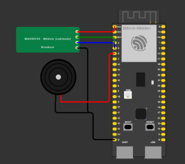

# Esquemas del circuito

## Cableado del prototipo

| Componente | Señal | ESP32-S3 |
| --- | --- | --- |
| MAX30102 | Alimentación | 3V3 |
| MAX30102 | SDA | GPIO4 |
| MAX30102 | SCL | GPIO5 |
| MAX30102 | GND | GND común |
| Zumbador KY-006 | Señal PWM | GPIO6 |
| Zumbador KY-006 | GND | GND común |

La asignación de pines coincide con la [plantilla de configuración del firmware de nube](../config.example.h). El circuito de batería LiPo, interruptor y carga estan conectados a la placa por el b- y b+. El interruptor interrumpe el camino de b+ para que no le llegue energia a la placa cuando este este desactivado. 

## Simulación inicial

La [captura de Wokwi](../Simulaci%C3%B3n.png) muestra la prueba del concepto de alarma con una señal simulada por potenciómetro.
