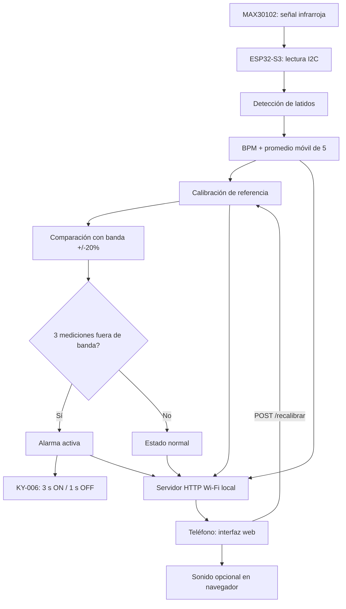

# Arquitectura del software

## Diagrama de bloques

## Módulos principales
1. **Inicialización (`setup`)**: abre puerto serie (115200), configura bus I²C GPIO4/GPIO5, PWM opcional GPIO6, detecta MAX30102, crea punto de acceso Wi-Fi e inicia servidor web.
2. **Lectura (`loop`)**: obtiene intensidad IR con `sensor.getIR()`; detecta presencia del dedo sobre umbral IR de 30000; identifica latidos con `checkForBeat()`.
3. **Cálculo y calibración**: calcula `BPM = 60000 / intervalo_ms` cuando el intervalo entre latidos está entre 333 y 1500 ms. Mantiene promedio móvil de las últimas cinco estimaciones. Durante la calibración, acumula mediciones; al completarse 30 segundos y 15 mediciones válidas establece la base fija.
4. **Decisión**: si el promedio móvil queda fuera del intervalo `[0.8 × base, 1.2 × base]` en tres mediciones consecutivas, activa la alarma; la desactiva al volver al rango válido o perder señal adecuada.
5. **Actuación**: si el KY-006 está habilitado y configurado correctamente, suena a 2000 Hz durante 3 segundos y descansa 1 segundo mientras dura la alarma.
6. **Comunicación**: entrega un HTML integrado y API JSON a través de un punto de acceso Wi-Fi propio (no requiere conectividad a Internet). La interfaz consulta estado aproximadamente cada 650 ms y puede emitir pitidos de audio si el usuario lo habilita.

## Endpoints implementados
| Método | Ruta | Resultado |
|---|---|---|
| GET | `/` | Página HTML/CSS/JS integrada en la memoria del firmware |
| GET | `/estado` | JSON con `ir`, `bpm`, `base`, `minimo`, `maximo`, `calibrado`, `dedo`, `alarma`, `datos`, `segundos` |
| POST | `/recalibrar` | Reinicia variables de detección y base; responde `{"ok":true}` |

## Parámetros del firmware
| Constante | Valor actual | Uso |
|---|---|---|
| `SDA_PIN` | 4 | Bus I²C SDA |
| `SCL_PIN` | 5 | Bus I²C SCL |
| `BUZZER_PIN` | 6 | Control PWM KY-006 |
| `UMBRAL_IR` | 30000 | Detección de dedo |
| `TIEMPO_CALIBRACION` | 30000 ms | Duración mínima de calibración |
| `DESVIACION` | 0.20 | Banda de alerta ±20 % |
| `CONFIRMACIONES` | 3 | Mediciones consecutivas fuera de rango |
| `N` | 5 | Tamaño del promedio móvil |

## Límites del diseño
- No incluye almacenamiento histórico permanente ni autenticación HTTP.
- La conexión Wi-Fi se utiliza como red local aislada, no como subida de datos a un servidor remoto.
- La alarma depende del algoritmo, la señal óptica y la disponibilidad del teléfono/zumbador.
- El rango ±20 % es un criterio de prototipo basado en calibración individual, no un umbral clínico validado.
- El sistema no ha sido validado físicamente al redactar estos documentos.
